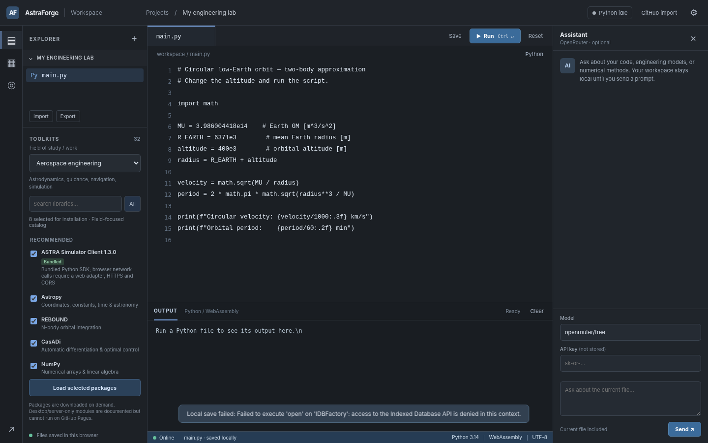

# AstraForge 4.3 — Engineering IDE + ASTRA Browser Engine

A browser-based Python 3.14 engineering IDE for static hosting on GitHub Pages. [Launch the IDE](https://eleman07.github.io/Astraforge/) · [Open the ASTRA 3D viewer](https://eleman07.github.io/ASTRA---Aerospace-Simulator/) · [Engineering portfolio](https://elemanprojects.com).



## ASTRA engine integration — no server required

**Version 4.3 eliminates the socket timeout caused by `urllib.request.urlopen` when running the ASTRA HTTP client within Pyodide.** The original `astra-simulator-client` 1.3.0 wheel is still installed from `wheels/`. When a file uses `AstraClient`, the IDE loads the real ASTRA Python physics modules into **the same Pyodide interpreter**, then patches only that interpreter's client's HTTP dispatch to invoke ASTRA's existing `browser_bridge.route_raw()` directly.

The ASTRA engine uses the original Python simulation algorithms: models, mission state, step/reset/launch, engineering analyses and other compatible endpoints. **No localhost server, VPS, remote API or CORS proxy is required** for these calls. Nothing is deployed as a server-side Python API.

First use downloads 22 Python source files from the public, MIT-licensed [ASTRA Aerospace Simulator](https://github.com/Eleman07/ASTRA-Aerospace-Simulator), pinned to commit `e5e8d16ae08d026d776e57f117fc677cb7084706`. The worker uses GitHub's raw file service with a jsDelivr mirror fallback; downloaded source is cached in the browser where Cache Storage is supported. The core Pyodide runtime also requires Internet access initially. The 3D viewer link opens a **separate simulation session**, not a synchronized renderer of the IDE's internal simulation state.

### First test

1. Open [AstraForge](https://eleman07.github.io/Astraforge/).
2. Select **Aerospace engineering**.
3. Click **Create ASTRA simulator example** (or paste the snippet below into a `.py` file).
4. Press **Run**. The wheel and 22 engine files load automatically the first time, without clicking “Load selected packages.”
5. Check the output for “ASTRA Browser Engine ready” and `ASTRA status`.

```python
from astra.client import AstraClient

sim = AstraClient()  # in-browser simulator; no HTTP requests
print(sim.status())
print(list(sim.models()))
sim.reset(vehicle='space', scenario='mission')
sim.launch()
for _ in range(5):
    state = sim.step(0.1)
    print(state.get('time_s'), state.get('altitude_m'))
```

Other SDK APIs such as `engineering()`, `vehicle_parts()`, `convergence()` and `robustness()` use the same dispatch layer. Some computationally intensive routines may exceed the execution limit or available RAM on mobile devices.

### Where the files are

| Path | Purpose |
|---|---|
| `worker.js` | Pyodide ES module worker, installer, ASTRA source loader and Python execution |
| `astra-bridge/engine-manifest.json` | Pinned upstream source manifest; 22 Python sources |
| `astra-bridge/browser_client_bridge.py` | In-process compatibility adapter preserving original SDK public methods |
| `wheels/astra_simulator_client-1.3.0-py3-none-any.whl` | User-provided original ASTRA SDK 1.3.0 |
| `examples/astra_browser_demo.py` | Standalone demonstration to paste into the browser editor |
| `sw.js` | PWA assets, cache version changed to v7 to invalidate earlier releases |

This implementation patches the Python client only **inside AstraForge's WebAssembly runtime**. Installing the wheel on ordinary desktop Python continues to use the original HTTP transport and requires `python server.py` if you want a native HTTP client. To launch that native server, see the source repo's `server.py`.

### Limitations

- Initial online access to the Pyodide CDN and pinned ASTRA code is required. Cached source may work later without a network, but offline behavior is not guaranteed on every browser.
- The current Github Pages PWA is not a general desktop runtime. Native Tkinter, a Django server, PyFME and arbitrary native libraries are not supported by the browser runtime.
- Code running in the tab is isolated from other users' browser tabs; the ASTRA online 3D viewer is not automatically connected to this physics state.
- This release was validated with automated JavaScript worker simulations and Python tests against the original ASTRA wheel, plus a local UI check. **Fetching and running ASTRA's actual source under the live GitHub Pages origin was not possible in the testing environment.** Test the real deployment before calling it fully verified.
- ASTRA is an experimental/educational simulator, not flight-certified software.

## IDE features

Python 3.14 using Pyodide 314.0.7; Web Worker execution; local workspace IndexedDB; import/export of Python files; matplotlib plots; OpenRouter copilot with user-provided API key; 16 STEM disciplines and 87 curated package listings. Desktop/server-only modules are clearly marked and not installed via Pyodide.

## Deploy to GitHub Pages

Run the commands described in [GITHUB_UPDATE_IT.md](GITHUB_UPDATE_IT.md). The repository is `Eleman07/Astraforge` (`main`, `/(root)`). Upload the **contents** of this directory to the repository root. Keep `astra-bridge/` and `wheels/` directories when updating. Then open [AstraForge](https://eleman07.github.io/Astraforge/) after Pages deploys; use `Ctrl+Shift+R` or unregister the old Service Worker if stale files remain.

## Tests

```bash
node --check app.js
node --check worker.js
node --check catalog.js
node tests/catalog.test.mjs
node tests/test_ast_sdk.cjs
node tests/test_ast_sdk_imports.cjs
node tests/test_browser_engine.cjs
python3 -m unittest discover -s tests -p 'test_browser_bridge.py' -v
```

All files can be tested locally with `python3 -m http.server 8080` from the directory root and `http://localhost:8080/`. Do not open `index.html` using `file://`.

## Licensing

ASTRA Aerospace Simulator's publicly available source is under the MIT License; see the [upstream LICENSE](https://github.com/Eleman07/ASTRA-Aerospace-Simulator/blob/main/LICENSE). The original SDK wheel is publicly downloadable when this IDE is published. Keep attribution and check your distribution rights before changing either component.
